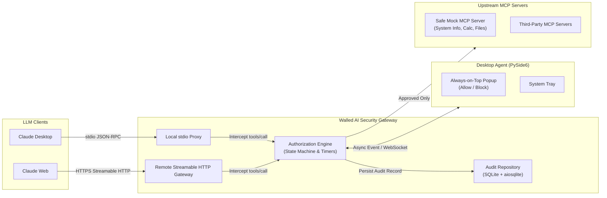

# Walled AI – MCP Communication Monitoring and User Authorization System

Production-grade Python-based MCP Security Gateway that intercepts MCP (Model Context Protocol) tool invocations initiated by Claude Desktop (via local stdio proxy) and Claude Web (via remote HTTPS/Streamable HTTP gateway).

Before any intercepted tool invocation reaches an upstream MCP server, the gateway halts execution and requests explicit user authorization through a desktop popup.

---

## Architecture Overview



---

## Core Security Tenets

1. **Default Deny / Fail-Closed**: No tool invocation reaches the upstream server unless explicitly authorized by the user. If a request times out, the desktop agent disconnects, or an exception occurs, the tool invocation is immediately aborted and an MCP tool error is returned.
2. **Strict State Machine**: Request lifecycle strictly follows `PENDING → APPROVED | REJECTED | TIMED_OUT | CANCELLED`. Once a terminal state is reached, transitions to any other state are physically disallowed by domain validation.
3. **Data Redaction**: Sensitive parameter keys (`password`, `token`, `secret`, `api_key`, `authorization`, `private_key`, `access_token`, `credential`) and bearer tokens in values are automatically sanitized (`[REDACTED]`) before presentation in the desktop GUI and persistence in audit logs. Untouched original arguments are forwarded only upon approval.
4. **Isolated Channels**: `stdout` is reserved exclusively for the MCP JSON-RPC protocol frames when running as a stdio proxy. All diagnostic logs and internal errors are routed strictly to `stderr`.

---

## Development Environment & Tech Stack

- **OS**: Windows 11 x64
- **Python**: 3.12 (explicitly enforced; Python 3.15 is never used)
- **MCP SDK**: Official Python MCP SDK (`mcp>=2.3.0`)
- **Desktop UI**: PySide6 (`PySide6>=6.12.0`) & `qasync`
- **Database**: SQLite with `aiosqlite`
- **Validation**: Pydantic v2 & `pydantic-settings`
- **Remote Gateway**: FastAPI & Uvicorn
- **Code Quality**: Ruff & Mypy
- **Testing**: pytest, pytest-asyncio, pytest-mock, pytest-cov

---

## Project Structure

```
app/
    main.py                   # Unified CLI entrypoint
    config.py                 # Pydantic Settings & stderr logger config
    gateway/
        local_proxy.py        # Local stdio MCP proxy
        upstream_manager.py   # Upstream server process management
    interception/
        request_parser.py     # MCP tools/call parser
        request_interceptor.py# Interception & routing logic
    authorization/
        manager.py            # Authorization coordinator
        pending_requests.py   # Concurrency-safe pending request registry
        decisions.py          # Decision processing & state transitions
    desktop/
        agent.py              # PySide6 desktop agent runner
        popup.py              # Always-on-top authorization dialog
        tray.py               # System tray icon and status
    storage/
        database.py           # aiosqlite connection management & migrations
        audit_repository.py   # Audit log persistence and queries
    models/
        requests.py           # Pydantic models, state machine, redaction
    remote/
        server.py             # FastAPI remote Streamable HTTP server
        agent_connection.py   # Authenticated WebSocket agent bridge

tests/
    unit/                     # Unit test suites
    integration/              # End-to-end integration test suites

examples/
    mock_mcp_server.py        # Safe demonstration upstream MCP server

docs/                         # Architecture documentation & diagrams
screenshots/                  # UI popup and tray captures
requirements.txt              # Production dependencies
requirements-dev.txt          # Development, testing, and linting dependencies
pyproject.toml                # Configuration for pytest, ruff, mypy
.env.example                  # Environment configuration template
.gitignore                    # Git exclusions
```

---

## Installation & Verification (Milestone 1)

### 1. Prerequisites
Ensure Python 3.12 is installed and available:
```powershell
py --list
python --version
```

### 2. Virtual Environment Setup
```powershell
python -m venv .venv
.\.venv\Scripts\Activate.ps1
python -m pip install --upgrade pip
pip install -r requirements-dev.txt
```

### 3. Verify Application Startup
```powershell
python -m app.main info
```

### 4. Run Automated Test Suite
```powershell
pytest -v --cov=app --cov-report=term-missing
```

### 5. Run Linting and Static Type Checking
```powershell
ruff check app tests
mypy app tests
```
